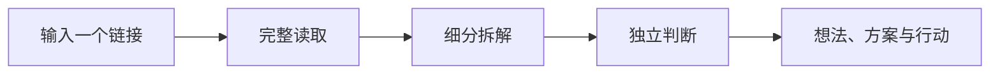
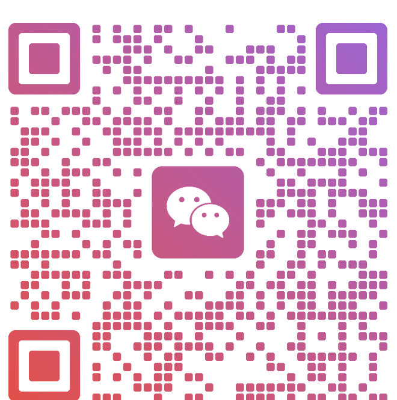

# kenton-link-lens

把一个链接真正吃透，再交付拆解、判断、想法、方案和下一步行动的 Agent Skill。

> 用着卡住了，可以找我答疑：99 元一个问题，24 小时内回。微信：JT_M0726

[crewup.cn](http://crewup.cn) · [Quickstart](docs/quickstart.md) · [故障排查](docs/troubleshooting.md) · [Issues](https://github.com/JefferyMaa/kenton-link-lens/issues) · [Discussions](https://github.com/JefferyMaa/kenton-link-lens/discussions) · [交流与反馈](#交流与反馈)

`kenton-link-lens` 适合处理 GitHub 仓库、视频、文章、网页和其他 URL。它约束 Agent 先完整读取证据，再分析内容，最后给出独立判断；它不是书签工具、自动归档器或“把一切都变成内容”的流水线。

## 你会得到什么

一次合格的 `kenton-link-lens` 结果应包含三个连续阶段：

1. **全部吃透看透**：读取完整内容，并说明证据缺口。
2. **细分分析**：拆开内容的组成、机制、论点和亮点。
3. **结论与行动**：给出判断、跨域想法、可执行方案和下一步。

如果链接无法访问，Skill 要求 Agent 明确说明卡点，不能用标题或摘要假装已经读完。

## 5 分钟 Quickstart

### 前置条件

- 一个支持目录式 `SKILL.md` 自定义 Skill 的 Agent 宿主。
- Agent 能访问你提供的链接；视频、登录页或受限内容可能需要额外授权或工具。
- 若任务需要下载大文件，先确认目标盘空间。

> 当前可执行资产只有 Skill 定义，不包含安装器、浏览器、下载器或 ASR 组件。具体 Skill 目录位置和自动发现方式由你的 Agent 宿主决定。

### 安装

克隆仓库，然后复制到宿主文档指定的 Skills 目录：

```bash
git clone https://github.com/JefferyMaa/kenton-link-lens.git
cp -R kenton-link-lens <YOUR_AGENT_SKILLS_DIR>/
```

重新启动宿主或开启新会话，确认可用 Skill 列表中出现 `kenton-link-lens`。

### 第一次使用

发送一个你有权访问的链接：

```text
帮我用 kenton-link-lens 深挖这个：<URL>
```

你可以用以下标准判断是否成功：

- Agent 说明实际读取了哪些内容，以及哪些部分读不到；
- 输出不止是摘要，而是按“读透 → 拆解 → 结论与行动”推进；
- 结论中至少包含可验证的判断和具体下一步；
- 没有把任务默认收窄成“存档、做内容或变现”。

更完整的首次使用说明见 [Quickstart](docs/quickstart.md)。

## 适合与不适合

适合：

- 判断一个 GitHub 仓库是否值得采用或继续研究；
- 吃透视频、文章或网页的完整论证；
- 从单条内容中提取机制、风险、可迁移模式和行动方案；
- 在证据不足时明确区分“已读取”与“无法确认”。

不适合：

- 只想保存书签或抓取网页；
- 只需要一段标题级摘要；
- 想在未授权的情况下绕过登录、付费墙或访问控制；
- 想分析某位创作者的完整内容语料并反推品牌战略——这种场景应使用 [`kenton-reverse-lens`](https://github.com/JefferyMaa/kenton-reverse-lens)。

## 工作方式



| 阶段 | Agent 要做什么 | 失败信号 |
|---|---|---|
| 读透 | 读取完整内容，保留证据和访问边界 | 只复述标题或 README 摘要 |
| 拆解 | 解释组成、机制、论点、亮点与限制 | 只给一段泛化总结 |
| 判断与行动 | 给出独立结论、想法、方案和下一步 | 只问要不要存档或做内容 |

## 下载与安全边界

`kenton-link-lens` 可能引导 Agent clone 仓库、抓取网页或下载视频，但 Skill 本身不提供这些执行能力。实际执行前应遵守宿主权限和以下边界：

- 下载前估算体积并检查目标盘余量；
- 大文件写入有空间的专用暂存盘，不默认塞进系统盘或桌面；
- 登录、付费、私有或受版权限制的内容只在获得授权后处理；
- 访问失败时报告失败，不用搜索摘要冒充完整阅读；
- 不在输出中暴露 Cookie、token、密钥或账号材料。

## 仓库内容

```text
.
├── SKILL.md
├── README.md
├── LICENSE
├── assets/
│   └── wechat-qr.png
├── docs/
│   ├── quickstart.md
│   └── troubleshooting.md
└── .gitignore
```

`SKILL.md` 是行为定义真源；README 和 `docs/` 只解释如何安装、触发和验收。

## 已知限制

- 当前没有安装脚本、测试套件、示例 fixture 或 CI。
- 当前没有声明具体 Agent 宿主、版本或平台兼容矩阵。
- 链接读取、浏览器、下载、转写和仓库分析能力取决于宿主及其工具。
- “完整读透”是否实现，需要通过实际任务证据验收，不能仅凭 Skill 已被发现来判断。

遇到问题见 [故障排查](docs/troubleshooting.md)。

## 关于 Kenton Ma

Kenton Ma 是一名独立开发者，持续用 AI 构建真实能用的内容与工具。更多项目见 [crewup.cn](http://crewup.cn)。

## 交流与反馈

使用问题和可复现 Bug，请通过 [GitHub Issues](https://github.com/JefferyMaa/kenton-link-lens/issues) 提交；方法讨论可以进入 [GitHub Discussions](https://github.com/JefferyMaa/kenton-link-lens/discussions)。想交流链接分析方法、获取项目动态或加入社群，可以扫码添加 Kenton Ma 微信，备注 `kenton-link-lens`。

<details>
  <summary>查看微信二维码</summary>
  <br>
  
  <p>若二维码失效，请访问 <a href="http://crewup.cn">crewup.cn</a> 获取最新联系方式。</p>
</details>

## License

本项目采用 [MIT License](LICENSE)。

## 联系 Kenton

- 个人博客：[Kenton Blog](https://kenton.crewup.cn/)
- 公开邮箱：[dilipkhandale351@gmail.com](mailto:dilipkhandale351@gmail.com)
